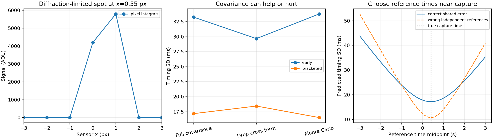

# Correlated motion references and camera timing

A 45–60 minute optics, camera, vision and mathematics lab. **When can a sharply localized spot still give a poorly known capture time?** Fit a diffraction spot, calibrate its motion from five finite reference observations, and propagate the *full* origin/velocity covariance into a timestamp. Move the reference times and deliberately drop correlations to see the effect on uncertainty and interval coverage.

This extends [motion calibration and timing](https://github.com/ahmetalpkilic/motion-calibration-timing-learning-lab). The new experiment is finite, correlated external position observations and reference-time design. The earlier timing gauge is a prerequisite; this lab deliberately fixes optics and uses a short exposure to isolate the new uncertainty question.

## Start here

Requires Python 3.9–3.12, a POSIX shell, and internet for the first dependency installation. Tested on Python 3.9 with the pinned requirements. No data downloads, account, or GPU required.

```sh
git clone https://github.com/ahmetalpkilic/correlated-motion-reference-learning-lab.git
cd correlated-motion-reference-learning-lab
sh run_demo.sh
```

The single runner creates `.venv`, installs pinned NumPy/SciPy/Matplotlib, runs eight tests and writes `outputs/results.json` and `outputs/experiment.png`. Subsequent experiments: `.venv/bin/python lab.py`; tests: `.venv/bin/python -m unittest -v`. Seed 20261001 fixes the synthetic experiment. Committed `examples/` contains the inspected baseline; floating point and PNG bytes can vary across platforms.

## Learning objectives and prerequisites

You should know Gaussian distributions, matrix multiplication, basic least squares and the relation distance = speed × time. After the lab, you can derive a pixel-integrated PSF from a Gaussian pupil; estimate a subpixel spot position; whiten correlated calibration observations; explain why fitted origin and velocity covary; and choose reference times that reduce timestamp uncertainty.

Suggested sequence: 5 minutes predicting results, 10 running/inspecting, 15 following the derivation and annotated code, 10 changing reference times, 10 completing an exercise.

| Area | Physical or mathematical connection | Code |
|---|---|---|
| Optics | Gaussian pupil Fourier transform gives the image-plane intensity width | `SIGMA`; pupil FFT test |
| Camera | Finite 4 µm pixels integrate that PSF, with known flux/background and read noise | `image`, `center_derivative` |
| Vision/metrology | Fit spot position b, infer capture time from calibrated motion | `fit_center`, `timing` |
| Mathematics | GLS, cross covariance, delta-method uncertainty, coverage and experiment design | `calibrate`, `demo` |

## Physical model and conventions

Use a 1D marginal of a separable ideal Gaussian pupil, monochromatic incoherent point imaging, wavelength λ = 550 nm, focal length f = 16 mm, pixel pitch p = 4 µm. Pupil amplitude is P(r) = exp[−r²/(2a²)], with a = f/(2N) = 1 mm and N = 8. **N is a Gaussian pupil scale, not the hard aperture f-number of a circular pupil.** There is no Airy pattern or hard pupil edge in this model.

Under the Fourier convention exp(−i2πqr), the amplitude transform is proportional to exp(−2π²a²q²), so the intensity variance in q is 1/(8π²a²). With x = λfq, the image width in pixels is

```text
σ = λf / (sqrt(8) π a p) = λN / (sqrt(2) πp) = 0.247587 px.
```

Sensor pixel centers are integer x = −8,…,8 and integrate over [x−0.5,x+0.5]. Coordinates increase to the right; the principal point is x=0. In a 2D embedding, K has fx=fy=f/p=4000 px, zero skew and principal point (0,0) in these centered coordinates. This is an image-plane motion experiment; no object-space distance calibration is inferred.

The ideal global-shutter exposure is instantaneous at nominal time 0 plus unknown offset δ. This is a short-exposure approximation: at v=0.8 px/s, a 1 ms exposure spans 0.0008 px, far below σ. A finite-duration shutter is not simulated here. Reference clock times are exact and independent of the camera clock. Motion is x(t)=c+vt with c=0.23 px, v=0.8 px/s and δ=0.4 s, hence b=0.55 px. There is no acceleration.

Integrated signal is F=10000 ADU with background B=20 ADU/pixel. Noise is independent zero-mean Gaussian read noise with SD 2 ADU/pixel. Photon noise, quantization, clipping, PRNU, dark noise, unknown gain and PSF mismatch are excluded. This is an ideal read-noise experiment, not a noise budget for a real 10000-ADU detector.

## Derivation, with code landmarks

### 1. Pixels to subpixel location

For standard Gaussian CDF Φ, the pixel mean is

```text
μ_j(b) = B + F [Φ((j+1/2−b)/σ) − Φ((j−1/2−b)/σ)].
```

`image` evaluates this exact spatial integral. `fit_center` minimizes Σ(y_j−μ_j)²/s_read². A signal-weighted centroid initializes the nonlinear fit, whose analytic derivative is implemented by `center_derivative`. Keeping flux, background and width known isolates position uncertainty. The local variance is

```text
s_b² ≈ s_read² / Σ_j (∂μ_j/∂b)².
```

This is a local Fisher/linearized prediction, not a claim that nonlinear estimation always attains the bound. Every Monte Carlo trial refits the actual noisy pixel profile.

### 2. Finite references to correlated motion parameters

Five external measurements obey z_i=c+vt_i+u+ε_i, where each calibration run has one shared offset u ~ N(0,τ²), τ=0.012 px, and independent ε_i ~ N(0,s²), s=0.015 px. These standard deviations are assumed known from independent characterization, not estimated from five observations. Therefore

```text
R = s² I + τ² 11ᵀ,    H_i = [1,t_i],    β = [c,v]ᵀ.
R = LLᵀ,    A=L⁻¹H,    y=L⁻¹z.
β̂ = argmin ||Aβ−y||²,    Cβ = (AᵀA)⁻¹.
```

`calibrate` uses Cholesky whitening and `lstsq`, rejects rank-deficient time layouts, and retains the off-diagonal covariance. With equal independent noise and this common offset model, the GLS point estimate happens to equal OLS. The covariance does **not** equal an independent-noise OLS covariance.

Let m be the reference-time mean, S=Σ(t_i−m)² and n=5. Direct algebra gives an independent check:

```text
Var(v̂) = s²/S
Cov(ĉ,v̂) = −m s²/S
Var(ĉ) = τ² + s²/n + m² s²/S.
```

Covariance units are px², px²/s and px²/s² respectively. The shared offset cannot average away with more references from the same calibration run.

### 3. Motion plus image to time

The plug-in estimate is δ̂=(b̂−ĉ)/v̂. For independent image and reference measurements,

```text
g = [−1/v, −δ/v]ᵀ
Var(δ̂) ≈ s_b²/v² + gᵀ Cβ g
         = [s_b² + Var(ĉ) + 2δ Cov(ĉ,v̂) + δ² Var(v̂)] / v²
         = [s_b² + τ² + s²/n + s²(δ−m)²/S] / v².
```

This last expression explains the design: keep references spread out (large S) and center them near the anticipated capture time (m≈δ). The exact δ is unknown in practice, so center around a prior estimate or sweep a plausible interval. The best midpoint in this demo is an oracle benchmark. The shared-offset floor is τ/|v| = 15 ms even with ideal images and infinitely many reference points.

### 4. Controlled errors

The demo compares early times [−3,−2.5,−2,−1.5,−1] s and times centered on δ, [−0.6,−0.1,0.4,0.9,1.4] s. It makes two separate mistakes on purpose:

- Drop only Cov(ĉ,v̂) while preserving their marginal variances. Early references have positive cross covariance and give overly narrow intervals; bracketed references have negative cross covariance and the shortcut is conservative.
- Replace the shared reference covariance R by diag(R). The design plot shows the incorrect uncertainty prediction from treating a shared offset as independent per observation. With this special equal-variance model, point estimates coincide but their quoted precision differs.

The 800 Monte Carlo trials draw a fresh shared offset, independent reference errors and independent camera noise on every run. Reported 95% coverage uses δ̂ ± 1.96 times the propagated SD evaluated at each fitted motion estimate. This is a local normal interval for a ratio: it can fail near zero velocity. Eight hundred trials give roughly ±1.5 percentage points of Monte Carlo variation near 95% coverage.

## Expected results and output



See `examples/results.json` for exact seeded values. The full covariance predicts roughly 33 ms timing SD with early references versus 17 ms when references bracket capture. Compare those predictions with actual Monte Carlo SD and the coverage columns. Dropping parameter cross covariance can move uncertainty either direction; it is not a universally conservative shortcut. The image is localized much more precisely than the motion calibration supports absolute timing.

## Validation

Eight tests cover independent numerical pixel integration and flux conservation; Fourier propagation of the pupil to the stated PSF width; noiseless subpixel recovery and analytic derivative; closed-form calibration covariance; whitening against dense GLS; analytic design optimum and shared-offset floor; 30000 independently generated linear calibration trials checking covariance/coverage; and unidentifiable reference times/zero-speed rejection. The deterministic demo adds 800 nonlinear image fits and end-to-end interval coverage for both reference layouts.

## Exercises

1. Before running, calculate the sign of Cov(ĉ,v̂) for both layouts. Predict which diagonal-only interval will be too narrow.
2. Change the common SD from 0.012 to 0.024 px. Predict the new floor. Then increase reference count and explain which component cannot improve.
3. Recenter the time coordinate t′=t−m and transform c′=c+vm and δ′=δ−m. Verify that full propagated uncertainty is invariant, while arbitrarily dropping covariance is not.
4. Change N from 8 to 16 and plot timing uncertainty against reference SD. Identify when sharper optical localization ceases to matter.
5. Add finite uniform exposure integration to the forward model and fit an instantaneous model. Sweep duration until bias becomes comparable to the quoted precision; validate the zero-duration limit first.

## Scope and limitations

Numerical recovery and repeatability are **not instrument accuracy**. This lab assumes known optical width and photometry, correct constant-velocity motion, independent calibrated reference clock, known spatial scale, Gaussian errors, and a shared offset that is random across calibration runs. A fixed unmodeled reference bias instead produces persistent timing bias. Real calibration uncertainty may include scale, reference-clock drift, thermal drift, nonstationary correlations, shutter shape and optical aberrations. The ratio estimator and local interval need reassessment for low speed or large uncertainty. No real-camera data are used.

## Sources, reuse and license review

Original educational implementation under MIT; the Gaussian-pupil/pixel-CDF convention follows the user's prior MIT [motion-calibration lab](https://github.com/ahmetalpkilic/motion-calibration-timing-learning-lab). Its attribution is preserved in `licenses/`. No upstream source code or data from third-party projects is copied.

Reviewed active public [prysm](https://github.com/brandondube/prysm) for physical-optics modeling (MIT), [SciPy](https://github.com/scipy/scipy) for optimization and linear algebra (BSD-3-Clause), [NumPy](https://github.com/numpy/numpy) for arrays (BSD-3-Clause), and [Matplotlib](https://github.com/matplotlib/matplotlib) for rendering (its permissive license). The [SciPy least-squares documentation](https://docs.scipy.org/doc/scipy/reference/generated/scipy.linalg.lstsq.html) describes the linear solver used here. `sources.json` records live commit hashes, commit messages/dates, push activity, archived state and pinned license URLs reviewed on 2026-10-01. Full license texts are preserved in `licenses/`; installed dependencies retain their own notices and bundled third-party licenses. Current upstream heads are provenance snapshots, not the older compatibility versions pinned for this runner. Prysm is a reference, not a dependency.

Next focused extension: external reference clock bias and drift, and which independent clock observation is required to distinguish clock error from camera timing.
